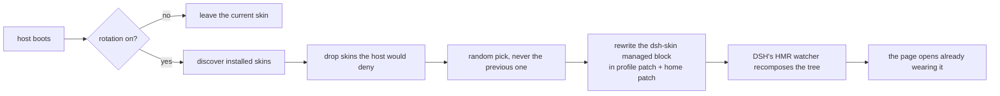

<p align="center">
  <strong>dsh-skin-rotation</strong><br/>
  <em>A different skin every launch — random skin rotation for DeepSeek Harness, with the switch where you expect it: inside Settings → Skins.</em>
</p>

<p align="center">
  <a href="LICENSE"></a>
  <a href="https://www.npmjs.com/package/dsh-skin-rotation"></a>
  <a href="https://github.com/luoyuejun9/dsh-skin-rotation/stargazers"></a>
  <a href="https://github.com/topics/dsh-plugin"></a>
</p>

<p align="center">English | <a href="README.zh.md">中文</a></p>

---

## What it does

You have four skins installed. You like all of them. You use one of them.

`dsh-skin-rotation` picks a different one at random every time DeepSeek Harness starts, and puts a switch inside the **Skins** settings page to turn that off. It never shows the same skin twice in a row, it only picks skins the host can actually load, and it keeps its hands off everything else.

```
launch 1 → 深海女仆工坊      launch 2 → 虎鲸链路      launch 3 → 鲸鱼娘昼夜工坊
```

## Install

From GitHub:

```sh
dsh plugin --profile web add github:luoyuejun9/dsh-skin-rotation
```

From npm:

```sh
dsh plugin --profile web add dsh-skin-rotation
```

Or from the prebuilt tarball attached to the [latest release](https://github.com/luoyuejun9/dsh-skin-rotation/releases/latest) — no build step, no `allowBuilds` prompt:

```sh
dsh plugin --profile web add https://github.com/luoyuejun9/dsh-skin-rotation/releases/latest/download/dsh-skin-rotation.tgz
```

Restart once. Then open **Settings → Skins**: the rotation card sits at the bottom of that page.

> Installing into the desktop app instead of the web profile? Use `--profile desktop`. The plugin works in both.

## The switch

```
Settings → Skins
├── Installed skins            ← the skin manager's own page
│   ├── 官方默认
│   ├── 深海女仆工坊  …
│   └── …
└── 🎲 Skin rotation           ← this plugin
    ├── [switch] Rotate skins on launch      2 skins in the pool
    ├── Current skin: 虎鲸链路 · Picked this launch: 虎鲸链路
    ├── 深海女仆工坊   虎鲸链路   鲸鱼娘昼夜工坊   DeepSeek 云鲸纸面
    └── [Shuffle now]  [Refresh]
```

| Control | What it does |
| --- | --- |
| **Rotate skins on launch** | On: every launch picks a random skin. Off: the launch leaves the current skin alone. |
| **Shuffle now** | Picks immediately and reloads the page. Works whether the switch is on or off. |
| **Skin list** | Who is in the pool. Skins the running host would refuse are marked and excluded. |

A manual switch in the skin manager still wins — until the next launch, which is the entire point.

## How it works



- **Rotation is a host-side decision, made once per launch.** A process-level boot key means a hot reload of the plugin re-runs `apply` without rotating again; a real restart does rotate. A browser refresh never re-rolls the dice.
- **It edits the patch layers, not the skins.** The plugin rewrites the same `# --- dsh-skin managed ---` block the skin manager owns, in both the profile patch and the higher-priority home patch. Every line outside that block — hand-written rows, comments, DSH's own appended settings rows — is preserved byte for byte, and writes go through a temp file plus rename.
- **It only picks skins the host will load.** DSH denies any plugin row whose `@deepseek-ai/dsh*` peer range excludes the running version: the patch still says `disabled: false`, the row simply never starts, and you get no skin at all. This plugin mirrors that admission check with its own SemVer range evaluator and honours the profile's `compatibility.json` grants, so a random pick cannot land on a dead skin.
- **The browser half is one card.** It observes the DOM, appends one container to the skin manager's page root, and renders the card into it. It registers no settings page of its own, keeps no global state, and removes every observer, timer and style tag it created when it unloads.
- **It never touches a skin's files, `skin.json`, or the manager's own state.**

### Files it writes

| Path | Content |
| --- | --- |
| `<profile>/cordis.patch.yml` | the shared `dsh-skin managed` mutual-exclusion block |
| `<DSH_HOME>/cordis.patch.yml` | the same block — higher priority, so it must agree |
| `<profile>/.dsh-skin-rotation.json` | this plugin's preference: switch, last pick, launch key, client report |

HTTP surface: `GET/POST /api/dsh/skin-rotation` — same-origin only, cross-site requests rejected.

## Requirements

- DeepSeek Harness web profile, `>=0.2.0-rc.2 <0.3.0-0` (declared as `engines.dsh`).
- At least two installed skins for rotation to mean anything. Skins are read the way the ecosystem defines them: a package shipping a valid `skin.json` (`id`, `package`, `bodyAttr`, `wiring.id`).
- The card lives inside the [skin manager](https://github.com/Small-tailqwq/dsh-deep-whale)'s Skins page (`settings.section` id `dsh-skins`). Without that manager rotation still works — you drive it through the route instead of a card.
- No `@deepseek-ai/*` runtime dependency: nothing to resolve, nothing to build, no install-time scripts.

## Development

```sh
node --test test/                 # 29 tests
npm pack --pack-destination dist  # build the release tarball
```

| Suite | What it covers |
| --- | --- |
| `test/host.test.mjs` | managed-block rewrite (including foreign-row survival), discovery against a live profile, random-pick rules, the once-per-launch guard, the two-layer write with rollback, route guards |
| `test/client-card.test.mjs` | the whole card render tree, driven through a stub module loader and stub React — no browser needed |
| `test/semver-oracle.test.mjs` | differential test against real node-semver over a generated matrix (skipped when node-semver is not installed) |
| `tools/e2e-rotation.sh` | boots a real host against an isolated `DSH_HOME`, repeatedly, and asserts the picked skin is what the browser is actually served |

The end-to-end script is the interesting one: it does not test the plugin's own opinion of what it did. It fetches the boot graph the browser receives and checks that exactly one skin is in it.

## FAQ

**Will it fight the skin manager?** No. Both write the same block using the same rules; the plugin rotates at launch and then stays out of the way.

**Does a browser refresh re-roll?** No — once per host process. Otherwise every page reload would be a new skin.

**What if I only have one skin?** Rotation is a no-op, and the block is still normalised.

**Can I keep my current skin?** Turn the switch off. The launch then leaves the skin alone, and manual switching is unaffected.

## License

MIT © luoyuejun9
