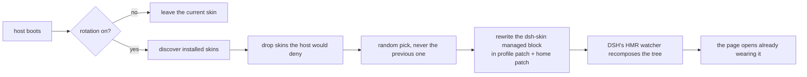

<p align="center">
  <strong>dsh-skin-rotation</strong><br/>
  <em>Smart skin rotation for DeepSeek Harness — random, sequential, weighted or fixed, with a per-skin pool, rotation history and crash-safe config writes. Local-first, recoverable, no extra API.</em>
</p>

<p align="center">
  <a href="LICENSE"></a>
  <a href="https://www.dsh.so/artifact/dsh-skin-rotation/"></a>
  <a href="https://github.com/luoyuejun9/dsh-skin-rotation/actions/workflows/test.yml"></a>
  <a href="https://www.npmjs.com/package/dsh-skin-rotation"></a>
  <a href="https://github.com/luoyuejun9/dsh-skin-rotation/stargazers"></a>
  <a href="https://github.com/topics/dsh-plugin"></a>
</p>

<p align="center">English | <a href="README.zh.md">中文</a></p>

---

## What it does

You have four skins installed. You like all of them. You use one of them.

`dsh-skin-rotation` applies **one rotation policy** on every launch of DeepSeek Harness and puts the controls inside the **Skins** settings page:

| Policy | Behaviour |
| --- | --- |
| `random` | a different skin each launch, optionally never the last 2 or 3 |
| `sequential` | walks your order, resuming at the right position after a restart |
| `weighted` | probability by weight per skin (weights need not total 100) |
| `fixed` | always one chosen skin — no automatic switching |

Everything about it is inspectable and reversible: which skins are in the pool and why the others are not, what was rotated when and why, and the last successful rotation you can restore with one click.

```
launch 1 → 深海女仆工坊      launch 2 → 虎鲸链路      launch 3 → 鲸鱼娘昼夜工坊
```

### Beyond a random pick

- **A real pool** — every installed skin is reported as `compatible`, `excluded`, `incompatible` or `unavailable`. Excluding a skin only removes it from rotation; installed files are never touched.
- **Only loadable skins** — DSH silently refuses a plugin row whose `@deepseek-ai/dsh*` peer range excludes the running version, so a naive rotation can land on a skin that never starts. This plugin mirrors that admission check and honours the profile's `compatibility.json` grants.
- **History you can read** — the last rotations with time, from → to, trigger (`startup` / `manual` / `restore`), mode and outcome. Failed rotations are recorded as failures; they never enter the "recent" set.
- **Restore previous** — one click returns to the most recent successful skin that is still usable.
- **Crash-safe writes** — a rotation edits two patch layers; a journal makes an interrupted write either finish or roll back on the next boot, and it refuses to overwrite files that changed in ways it cannot explain.
- **Versioned state** — the state file carries a `schemaVersion` and migrates forward, so upgrades do not lose your preferences.

## Install

From GitHub:

```sh
dsh plugin --profile web add github:luoyuejun9/dsh-skin-rotation
```

From npm:

```sh
dsh plugin --profile web add dsh-skin-rotation
```

Or from the prebuilt tarball attached to the [latest release](https://github.com/luoyuejun9/dsh-skin-rotation/releases/latest) — no build step, no `allowBuilds` prompt:

```sh
dsh plugin --profile web add https://github.com/luoyuejun9/dsh-skin-rotation/releases/latest/download/dsh-skin-rotation.tgz
```

Restart once. Then open **Settings → Skins**: the rotation card sits at the bottom of that page.

> Installing into the desktop app instead of the web profile? Use `--profile desktop`. The plugin works in both.

## The card

```
Settings → Skins
├── Installed skins            ← the skin manager's own page
└── 🎲 Skin rotation           ← this plugin
    ├── [switch] Rotate on launch        Mode: [random ▾]   Avoid recent: [last 2 ▾]
    ├── Current skin: 虎鲸链路 · 2 in pool
    ├── ☑ 虎鲸链路        · weight [3]
    ├── ☐ 深海女仆工坊    (excluded)
    ├── ☐ 不兼容皮肤      (incompatible — excluded)
    ├── [Shuffle now] [Restore previous] [Refresh]
    ├── Recent rotations
    │     2026-10-11 21:04 · startup · official → 虎鲸链路 · ok
    └── ▸ Advanced   (weights, reset to defaults)
```

| Control | What it does |
| --- | --- |
| **Rotate on launch** | Off means the launch leaves the current skin alone. `Shuffle now` still works. |
| **Mode** | `random` / `sequential` / `weighted` / `fixed`. In `fixed` you pick the skin; nothing rotates automatically. |
| **Avoid recent** | Prefers a skin that was not among the last 2 or 3 *successful* rotations. It is a preference, never a blocker: with nowhere fresh to go it still picks one and says so. |
| **Skin checkboxes** | Pool membership. Unchecking is an exclusion, not an uninstall. Incompatible skins cannot be re-enabled. |
| **Weights** | Shown in `weighted` mode. `0` removes a skin from the draw; an empty box means the default weight `1`. |
| **Restore previous** | Returns to the most recent successful skin that is still in the pool, and records the restore in the history. |

A manual switch in the skin manager still wins — until the next launch, which is the entire point.

## How it works



- **Rotation is a host-side decision, made once per launch.** A process-level boot key means a hot reload of the plugin re-runs `apply` without rotating again; a real restart does rotate. A browser refresh never re-rolls the dice.
- **It edits the patch layers, not the skins.** The plugin rewrites the same `# --- dsh-skin managed ---` block the skin manager owns, in both the profile patch and the higher-priority home patch. Every line outside that block — hand-written rows, comments, DSH's own appended settings rows — is preserved byte for byte, and writes go through a temp file plus rename.
- **It only picks skins the host will load.** DSH denies any plugin row whose `@deepseek-ai/dsh*` peer range excludes the running version: the patch still says `disabled: false`, the row simply never starts, and you get no skin at all. This plugin mirrors that admission check with its own SemVer range evaluator and honours the profile's `compatibility.json` grants, so a random pick cannot land on a dead skin.
- **The browser half is one card.** It observes the DOM, appends one container to the skin manager's page root, and renders the card into it. It registers no settings page of its own, keeps no global state, and removes every observer, timer and style tag it created when it unloads.
- **It never touches a skin's files, `skin.json`, or the manager's own state.**

### Files it writes

| Path | Content |
| --- | --- |
| `<profile>/cordis.patch.yml` | the shared `dsh-skin managed` mutual-exclusion block |
| `<DSH_HOME>/cordis.patch.yml` | the same block — higher priority, so it must agree |
| `<profile>/.dsh-skin-rotation.json` | this plugin's preference: switch, last pick, launch key, client report |

HTTP surface: `GET/POST /api/dsh/skin-rotation` — same-origin only, cross-site requests rejected.

## Requirements

- DeepSeek Harness web profile, `>=0.2.0-rc.2 <0.3.0-0` (declared as `engines.dsh`).
- At least two installed skins for rotation to mean anything. Skins are read the way the ecosystem defines them: a package shipping a valid `skin.json` (`id`, `package`, `bodyAttr`, `wiring.id`).
- The card lives inside the [skin manager](https://github.com/Small-tailqwq/dsh-deep-whale)'s Skins page (`settings.section` id `dsh-skins`). Without that manager rotation still works — you drive it through the route instead of a card.
- No `@deepseek-ai/*` runtime dependency: nothing to resolve, nothing to build, no install-time scripts.
- Windows and POSIX both work: writes go to a temp file plus rename, and the recovery journal is plain JSON.
- Independently indexed by [dsh.so](https://www.dsh.so/artifact/dsh-skin-rotation/): security audit done (low risk), `L5` install verification — run tested on dsh `0.2.0-rc.2`.

## Development

```sh
node --test                       # 29 tests
npm pack --pack-destination dist  # build the release tarball
```

| Suite | What it covers |
| --- | --- |
| `test/host.test.mjs` | managed-block rewrite (including foreign-row survival), discovery against a live profile, random-pick rules, the once-per-launch guard, the two-layer write with rollback, route guards |
| `test/client-card.test.mjs` | the whole card render tree, driven through a stub module loader and stub React — no browser needed |
| `test/semver-oracle.test.mjs` | differential test against real node-semver over a generated matrix (skipped when node-semver is not installed) |
| `tools/e2e-rotation.sh` | boots a real host against an isolated `DSH_HOME`, repeatedly, and asserts the picked skin is what the browser is actually served |

The end-to-end script is the interesting one: it does not test the plugin's own opinion of what it did. It fetches the boot graph the browser receives and checks that exactly one skin is in it.

## FAQ

**Will it fight the skin manager?** No. Both write the same block using the same rules; the plugin rotates at launch and then stays out of the way.

**Does a browser refresh re-roll?** No — once per host process. Otherwise every page reload would be a new skin.

**What if I only have one skin?** Rotation is a no-op, and the block is still normalised.

**Can I keep my current skin?** Turn the switch off. The launch then leaves the skin alone, and manual switching is unaffected.

## Scope

This plugin manages **rotation over the skins you already installed**: the pool, the policy, the history, and the reliability of the config write. It deliberately does not install, download, uninstall or preview skins, and it does not replace a skin manager or a market — those exist and this plugin works alongside them.

## Roadmap

- Rotation presets are saved and switchable today; a visual preset editor is not planned yet.
- A rotation seed exists in the state file for reproducible runs; it is not exposed in the UI.
- Session-scoped theming (a different skin per session) is **not** implemented: DSH has no public, stable per-session theme switch. It stays on the roadmap rather than being faked with DOM workarounds.

## License

MIT © luoyuejun9
