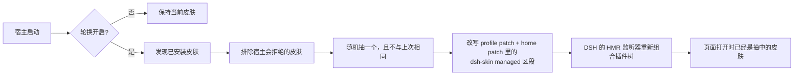

<p align="center">
  <strong>dsh-skin-rotation</strong><br/>
  <em>DeepSeek Harness 智能皮肤轮换 —— 随机 / 顺序 / 加权 / 固定四种策略，可筛选候选池、可查轮换历史、配置写入崩溃安全。纯本地运行，不需要额外 AI API。</em>
</p>

<p align="center">
  <a href="LICENSE"></a>
  <a href="https://www.dsh.so/artifact/dsh-skin-rotation/"></a>
  <a href="https://github.com/luoyuejun9/dsh-skin-rotation/actions/workflows/test.yml"></a>
  <a href="https://www.npmjs.com/package/dsh-skin-rotation"></a>
  <a href="https://github.com/luoyuejun9/dsh-skin-rotation/stargazers"></a>
  <a href="https://github.com/topics/dsh-plugin"></a>
</p>

<p align="center"><a href="README.md">English</a> | 中文</p>

---

## 它做什么

你装了四个皮肤，四个都喜欢，但每次只用其中一个。

`dsh-skin-rotation` 会在每次启动 DeepSeek Harness 时按**你选的轮换策略**启用一个皮肤，控制项都在「设置 → 皮肤」页里：

| 策略 | 行为 |
| --- | --- |
| `random` 随机 | 每次启动换一个，可选避开最近 2 / 3 次用过的 |
| `sequential` 顺序 | 按你的顺序依次轮换，重启后从正确位置继续 |
| `weighted` 加权 | 按权重比例抽取（权重不必凑成 100） |
| `fixed` 固定 | 始终使用指定皮肤，不做自动切换 |

它同时是**可解释、可恢复**的：哪些皮肤在候选池里、其余为什么被排除、什么时候换过什么、上一次成功的皮肤是哪一只（一键恢复）。

```
第 1 次启动 → 深海女仆工坊      第 2 次启动 → 虎鲸链路      第 3 次启动 → 鲸鱼娘昼夜工坊
```

### 不只是"随便抽一个"

- **真正的候选池**：每个已安装皮肤都会被标为 `compatible`（参与）/ `excluded`（你排除的）/ `incompatible`（宿主不兼容）/ `unavailable`（读不到）。**排除 ≠ 卸载**，插件绝不碰你已安装的文件。
- **只抽宿主真能加载的皮肤**：DSH 会拒绝 `@deepseek-ai/dsh*` peer 范围不含当前运行时的插件行（补丁写着启用、但行根本不启动），naive 的随机可能抽到"死皮肤"导致一个皮肤都没有。本插件复刻了这道准入判定，并读取 profile 的 `compatibility.json` 放行记录。
- **可读的轮换历史**：时间、从哪只到哪只、触发原因（`startup` / `manual` / `restore`）、策略、结果。失败会如实记为失败，且不会进入"最近使用"集合。
- **恢复上一皮肤**：一键回到最近一次成功、且当前仍在候选池里的皮肤。
- **崩溃安全的配置写入**：轮换要改两层补丁文件，事务日志保证被中断的写入在下次启动时要么补完、要么回滚；对于"变了但不是它改的"文件，它拒绝覆盖并给出诊断。
- **带版本的状态文件**：`schemaVersion` + 向前迁移，升级不丢偏好。

## 安装

从 GitHub 一行装：

```sh
dsh plugin --profile web add github:luoyuejun9/dsh-skin-rotation
```

从 npm 装：

```sh
dsh plugin --profile web add dsh-skin-rotation
```

或者用 [最新 Release](https://github.com/luoyuejun9/dsh-skin-rotation/releases/latest) 上的预构建 tarball——不需要构建，也不会触发 `allowBuilds` 授权：

```sh
dsh plugin --profile web add https://github.com/luoyuejun9/dsh-skin-rotation/releases/latest/download/dsh-skin-rotation.tgz
```

重启一次，然后打开「设置 → 皮肤」，轮换卡片就在这个页面底部。

> 装进桌面端而不是 web profile？把 `--profile web` 换成 `--profile desktop` 即可，两边都能用。

## 设置卡片

```
设置 → 皮肤
├── 已安装皮肤                 ← 皮肤管理器自己的页面
└── 🎲 皮肤轮换                ← 本插件
    ├── [开关] 启动时自动轮换     轮换模式：[随机 ▾]   近期不重复：[避开最近 2 个 ▾]
    ├── 当前皮肤：虎鲸链路 · 候选池 2 个
    ├── ☑ 虎鲸链路        · 权重 [3]
    ├── ☐ 深海女仆工坊    （已排除）
    ├── ☐ 不兼容皮肤      （不兼容，已排除）
    ├── [立即换一个] [恢复上一皮肤] [重新读取]
    ├── 最近轮换
    │     2026-10-11 21:04 · 启动 · 官方默认 → 虎鲸链路 · 成功
    └── ▸ 高级设置   （权重说明、恢复默认配置）
```

| 控件 | 作用 |
| --- | --- |
| **启动时自动轮换** | 关闭后启动不改动皮肤；「立即换一个」仍然可用。 |
| **轮换模式** | `random` / `sequential` / `weighted` / `fixed`。`fixed` 下你指定皮肤，不再自动切换。 |
| **近期不重复** | 优先避开最近 2 / 3 次**成功**轮换用过的皮肤。这只是偏好、不是阻塞：当候选池里全是"最近用过"的，它照样会选一个并如实说明。 |
| **皮肤勾选框** | 是否参与轮换。取消勾选 = 排除，不是卸载；不兼容的皮肤不可被勾选。 |
| **权重** | 仅 `weighted` 模式显示；填 `0` 表示不参与抽取，留空表示默认权重 `1`。 |
| **恢复上一皮肤** | 回到最近一次成功且仍在候选池中的皮肤，并在历史里记为一次 `restore`。 |

在皮肤管理器里手动切换皮肤依然有效——直到下次启动，这正是这个插件的意义。

## 工作原理



- **轮换是宿主侧的决定，一次启动只做一次。** 进程级 boot key 保证插件被热重载时不会重复抽签，真正重启才会重抽；浏览器刷新不会重掷骰子。
- **它改的是补丁层，不是皮肤。** 插件改写的是皮肤管理器自己也在用的那段 `# --- dsh-skin managed ---` 互斥区段，profile patch 与优先级更高的 home patch 一起改。区段之外的一切——手写行、注释、DSH 自己追加的设置行——原样保留，写入走临时文件 + rename 的原子替换。
- **只抽宿主真能加载的皮肤。** DSH 会拒绝那些 `@deepseek-ai/dsh*` peer 范围不含当前运行时的插件行：补丁里写着 `disabled: false`，行却根本不会启动，结果是一个皮肤都没有。本插件用自己的语义化版本求值器复刻了这道准入判定，并读取 profile 的 `compatibility.json` 放行记录，因此随机结果不会落到死皮肤上。
- **浏览器半区只有一张卡片。** 它监听 DOM，往皮肤管理器页面根节点追加一个容器，把卡片渲染进去；不注册自己的设置页、不留全局状态，卸载时清掉自己创建的 observer、定时器和样式。
- **不碰皮肤文件、`skin.json`，也不接管管理器自己的状态。**

### 写入的文件

| 路径 | 内容 |
| --- | --- |
| `<profile>/cordis.patch.yml` | 共用 `dsh-skin managed` 互斥区段 |
| `<DSH_HOME>/cordis.patch.yml` | 同一区段——优先级更高，必须一起改 |
| `<profile>/.dsh-skin-rotation.json` | 本插件自己的偏好：开关、上次抽中的皮肤、启动标识、客户端回报 |

HTTP 接口：`GET/POST /api/dsh/skin-rotation`，仅同源，跨站请求直接拒绝。

## 环境要求

- DeepSeek Harness web profile，`>=0.2.0-rc.2 <0.3.0-0`（声明在 `engines.dsh`）。
- 至少装两个皮肤轮换才有意义。皮肤的判定沿用生态约定：包内带合法 `skin.json`（`id`、`package`、`bodyAttr`、`wiring.id`）。
- 卡片挂在[皮肤管理器](https://github.com/Small-tailqwq/dsh-deep-whale)的皮肤页（`settings.section` id `dsh-skins`）里；没有管理器时轮换依然工作，只是改用路由开关。
- 不依赖任何 `@deepseek-ai/*` 运行时包：无需解析、无需构建、安装时不执行任何脚本。
- Windows 与 POSIX 都适用：写入用临时文件 + rename，恢复日志是纯 JSON。
- 已被 [dsh.so](https://www.dsh.so/artifact/dsh-skin-rotation/) 独立收录：安全审计通过（低风险），安装验证 `L5`（已在 dsh `0.2.0-rc.2` 上实机跑通）。

## 开发

```sh
node --test                       # 29 个用例
npm pack --pack-destination dist  # 打包发布用的 tarball
```

| 测试 | 覆盖内容 |
| --- | --- |
| `test/host.test.mjs` | 区段改写（含区段外记录保留）、真实 profile 的发现、随机规则、启动一次性、双层写入与回滚、路由防护 |
| `test/client-card.test.mjs` | 整棵卡片渲染树，通过桩模块加载器 + 桩 React 驱动，不需要浏览器 |
| `test/semver-oracle.test.mjs` | 与真实 node-semver 的差分验证，覆盖生成的组合矩阵（本机没装时自动跳过） |
| `tools/e2e-rotation.sh` | 在独立 `DSH_HOME` 下真实启动宿主多次，断言抽中的皮肤就是浏览器实际拿到的那个 |

端到端脚本是里面最有意思的一个：它不验证插件「自认为」做了什么，而是去取浏览器实际收到的 boot graph，确认里面只有一个皮肤模块。

## FAQ

**会和皮肤管理器打架吗？** 不会。两边用同一套规则写同一段区段；本插件只在启动时轮换，之后完全不插手。

**浏览器刷新会重抽吗？** 不会——每个宿主进程只抽一次，否则每次刷新都换皮肤。

**只装了一个皮肤呢？** 轮换等于不换，区段照样会被规范化。

**能一直用我现在这个皮肤吗？** 关掉开关即可，启动不再改动皮肤，手动切换也不受影响。

## 项目边界

本插件只管**在你已安装的皮肤之间轮换**：候选池、策略、历史记录与配置写入的可靠性。它刻意不做皮肤的安装、下载、卸载和预览，也不取代皮肤管理器或插件市场——那些已经有成熟项目，本插件与它们并存。

## 路线图

- 轮换方案（Presets）已支持保存与一键切换；可视化的方案编辑器暂不在计划内。
- 状态文件里保留了随机种子（seed）字段，用于可复现的运行；暂未在 UI 暴露。
- **会话级主题**（不同会话用不同皮肤）**未实现**：DSH 当前没有公开、稳定的会话级主题切换接口，因此它留在路线图里，而不是用不可靠的 DOM 手段假装做到。

## License

MIT © luoyuejun9
